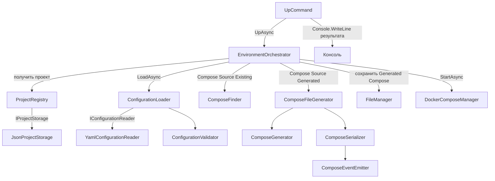

# Архитектура Dciex

Документ описывает текущую структуру Solution и поведение команды `dciex up`.

## Назначение проектов

- **Dciex.Core** содержит предметные модели и перечисления без зависимостей от других проектов: например, `Project`, `ProjectStatus`, `EnvironmentConfiguration`, `ServiceConfiguration` и настройки источника Compose.
- **Dciex.Application** содержит сценарии и контракты приложения. `ProjectRegistry` управляет зарегистрированными проектами через `IProjectStorage`; `ConfigurationLoader` читает конфигурацию через `IConfigurationReader` и передаёт её в `ConfigurationValidator`; `EnvironmentOrchestrator` координирует запуск среды через контракты Application.
- **Dciex.Infrastructure** реализует контракты Application и содержит операции с внешней средой и файлами. Примеры: `JsonProjectStorage`, `YamlConfigurationReader`, `ComposeFinder`, `ComposeFileGenerator`, `FileManager` и `DockerComposeManager`.
- **Dciex.CLI** собирает зависимости в `Program.cs`, регистрирует реализации в DI и предоставляет команды System.CommandLine. `UpCommand` вызывает `EnvironmentOrchestrator` и выводит результат.
- **Dciex.Tests** содержит тесты конфигурации, поиска и генерации Compose, `EnvironmentOrchestrator` и `DockerComposeManager`. Для тестов запуска Docker используется вспомогательный проект `FakeDocker`.

## Правила зависимостей

Фактические `ProjectReference` в Solution задают следующие направления:

```text
Dciex.Core           → нет ссылок на другие проекты
Dciex.Application    → Dciex.Core
Dciex.Infrastructure → Dciex.Application, Dciex.Core
Dciex.CLI            → Dciex.Application, Dciex.Infrastructure
Dciex.Tests          → Dciex.Application, Dciex.Infrastructure, Dciex.Core
```

Это соответствует основным правилам: Core независим; Application использует Core; Infrastructure реализует контракты Application и использует Core; CLI подключает Application и Infrastructure, настраивает DI и предоставляет интерфейс командной строки. Tests ссылается на слои, поведение которых проверяет. Отдельный проект CLI напрямую не ссылается на Core, а получает его типы через ссылки Application и Infrastructure.

## Карта основных компонентов

Стрелки показывают вызовы или использование контракта. Реализации контрактов расположены в Infrastructure.



## Жизненный цикл `dciex up`

1. `Program.cs` настраивает DI, добавляет `UpCommand` в корневую команду, CLI разбирает аргументы и вызывает команду.
2. `UpCommand` получает `EnvironmentOrchestrator` из `IServiceProvider` и передаёт ему имя проекта.
3. `EnvironmentOrchestrator` загружает проект через `ProjectRegistry` и `IProjectStorage`. Если проект не найден или реестр не удалось прочитать, возвращается ошибка операции.
4. Для найденного проекта загружается `devenv.yaml` через `ConfigurationLoader`. Если файл прочитан, `ConfigurationValidator` проверяет конфигурацию. Ошибки чтения или валидации завершают операцию.
5. Источник Compose берётся из `Compose.Source`; если настройка не задана, модель использует `Generated`. Единственное исключение — отсутствующий `devenv.yaml`: тогда включается режим `Existing`.
6. Для `Generated` `ComposeFileGenerator` формирует и сериализует конфигурацию, а `FileManager` сохраняет результат как `<project>/.dciex/compose.yaml`.
7. Для `Existing` `ComposeFinder` ищет Compose-файл только в корне каталога проекта. Поддерживаются `compose.yaml`, `compose.yml`, `docker-compose.yaml` и `docker-compose.yml` без учёта регистра имени. Отсутствие файла, несколько совпадений или недоступный каталог приводят к ошибке.
8. `DockerComposeManager` запускает `docker compose -f <путь> up -d` из каталога проекта и собирает код завершения и потоки вывода. Неуспешный код или ошибка запуска процесса преобразуются оркестратором в результат ошибки.
9. `EnvironmentOrchestrator` возвращает `EnvironmentOperationResult`; `UpCommand` выводит сообщение об успехе или ошибке.

В текущем поведении отсутствующий `devenv.yaml` разрешён только для сценария с существующим Compose. Пустой, некорректный или невалидный файл не переключает операцию на `Existing`. При нескольких найденных Compose-файлах автоматически выбрать один нельзя. Генерация записывает фиксированный путь `.dciex/compose.yaml` внутри каталога проекта. Внешний запуск выполняет локальный Docker CLI; `UpCommand` не управляет Docker самостоятельно.

## Архитектурные соглашения

- Не управлять Docker непосредственно из CLI: запуск проходит через `EnvironmentOrchestrator` и контракт `IDockerComposeManager`.
- Не допускать зависимости Core от Infrastructure.
- Не создавать интерфейсы без практической необходимости.
- Не дробить компоненты без реальной причины.
- Не вводить абстракции только ради формального соблюдения SOLID.
- Размещать инфраструктурные операции за соответствующими контрактами Application, как это сделано для чтения конфигурации, хранения проектов, поиска и записи файлов и запуска Docker Compose.
