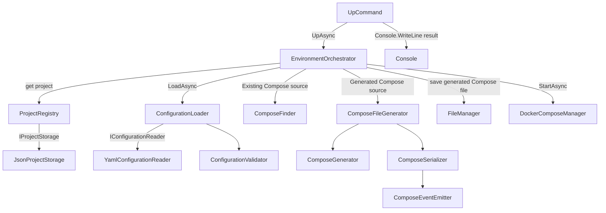

# Dciex Architecture

This document describes the current Solution structure and the behavior of the `dciex up` command.

## Project responsibilities

- **Dciex.Core** contains domain models and enumerations with no dependencies on other projects, such as `Project`, `ProjectStatus`, `EnvironmentConfiguration`, `ServiceConfiguration`, and Compose source settings.
- **Dciex.Application** contains application use cases and contracts. `ProjectRegistry` manages registered projects through `IProjectStorage`; `ConfigurationLoader` reads configuration through `IConfigurationReader` and passes it to `ConfigurationValidator`; `EnvironmentOrchestrator` coordinates environment startup through Application contracts.
- **Dciex.Infrastructure** implements Application contracts and contains operations involving the external environment and files. Examples: `JsonProjectStorage`, `YamlConfigurationReader`, `ComposeFinder`, `ComposeFileGenerator`, `FileManager`, and `DockerComposeManager`.
- **Dciex.CLI** assembles dependencies in `Program.cs`, registers implementations in DI, and provides System.CommandLine commands. `UpCommand` calls `EnvironmentOrchestrator` and prints the result.
- **Dciex.Tests** contains tests for configuration, Compose discovery and generation, `EnvironmentOrchestrator`, and `DockerComposeManager`. Docker startup tests use the helper project `FakeDocker`.

## Dependency rules

The actual `ProjectReference` entries in the Solution define the following directions:

```text
Dciex.Core           → no references to other projects
Dciex.Application    → Dciex.Core
Dciex.Infrastructure → Dciex.Application, Dciex.Core
Dciex.CLI            → Dciex.Application, Dciex.Infrastructure
Dciex.Tests          → Dciex.Application, Dciex.Infrastructure, Dciex.Core
```

This matches the main rules: Core is independent; Application uses Core; Infrastructure implements Application contracts and uses Core; CLI connects Application and Infrastructure, configures DI, and provides the command-line interface. Tests reference the layers whose behavior they verify. The CLI project does not directly reference Core; it gets its types through references to Application and Infrastructure.

## Main component map

Arrows show calls or use of a contract. Contract implementations are located in Infrastructure.



## `dciex up` lifecycle

1. `Program.cs` configures DI, adds `UpCommand` to the root command, and the CLI parses the arguments and invokes the command.
2. `UpCommand` obtains `EnvironmentOrchestrator` from `IServiceProvider` and passes it the project name.
3. `EnvironmentOrchestrator` loads the project through `ProjectRegistry` and `IProjectStorage`. If the project is not found or the registry cannot be read, an operation error is returned.
4. For a found project, `devenv.yaml` is loaded through `ConfigurationLoader`. If the file is read, `ConfigurationValidator` validates the configuration. Read or validation errors terminate the operation.
5. The Compose source comes from `Compose.Source`; if the setting is not specified, the model uses `Generated`. The only exception is a missing `devenv.yaml`: in that case, `Existing` mode is enabled.
6. For `Generated`, `ComposeFileGenerator` builds and serializes the configuration, and `FileManager` saves the result as `<project path>/compose.yaml`.
7. For `Existing`, `ComposeFinder` searches for a Compose file only in the root of the project directory. It supports `compose.yaml`, `compose.yml`, `docker-compose.yaml`, and `docker-compose.yml`, regardless of filename case. A missing file, multiple matches, or an inaccessible directory results in an error.
8. `DockerComposeManager` runs `docker compose -f <path> up -d` from the project directory and collects the exit code and output streams. A non-zero code or process startup error is converted by the orchestrator into an error result.
9. `EnvironmentOrchestrator` returns `EnvironmentOperationResult`; `UpCommand` prints a success or error message.

Under current behavior, a missing `devenv.yaml` is allowed only for the scenario using an existing Compose file. An empty, malformed, or invalid file does not switch the operation to `Existing`. If multiple Compose files are found, one cannot be selected automatically. Generation writes to the fixed path `compose.yaml`. The external process runs the local Docker CLI; `UpCommand` does not manage Docker itself.

## Architectural conventions

- Do not manage Docker directly from the CLI: startup goes through `EnvironmentOrchestrator` and the `IDockerComposeManager` contract.
- Do not allow Core to depend on Infrastructure.
- Do not create interfaces without a practical need.
- Do not split components without a real reason.
- Do not introduce abstractions solely to formally comply with SOLID.
- Place infrastructure operations behind the corresponding Application contracts, as is done for configuration reading, project storage, file discovery and writing, and Docker Compose startup.
