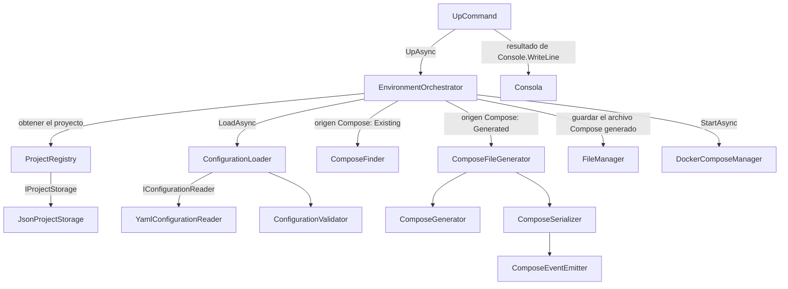

# Arquitectura de Dciex

Este documento describe la estructura actual de la solución y el comportamiento del comando `dciex up`.

## Responsabilidades de los proyectos

- **Dciex.Core** contiene modelos de dominio y enumeraciones sin dependencias de otros proyectos, por ejemplo, `Project`, `ProjectStatus`, `EnvironmentConfiguration`, `ServiceConfiguration` y la configuración del origen de Compose.
- **Dciex.Application** contiene casos de uso y contratos de la aplicación. `ProjectRegistry` administra los proyectos registrados mediante `IProjectStorage`; `ConfigurationLoader` lee la configuración mediante `IConfigurationReader` y la pasa a `ConfigurationValidator`; `EnvironmentOrchestrator` coordina el inicio del entorno mediante contratos de Application.
- **Dciex.Infrastructure** implementa contratos de Application y contiene operaciones con el entorno externo y los archivos. Algunos ejemplos: `JsonProjectStorage`, `YamlConfigurationReader`, `ComposeFinder`, `ComposeFileGenerator`, `FileManager` y `DockerComposeManager`.
- **Dciex.CLI** reúne las dependencias en `Program.cs`, registra las implementaciones en DI y proporciona comandos de System.CommandLine. `UpCommand` llama a `EnvironmentOrchestrator` y muestra el resultado.
- **Dciex.Tests** contiene pruebas de configuración, búsqueda y generación de Compose, `EnvironmentOrchestrator` y `DockerComposeManager`. Las pruebas que inician Docker utilizan el proyecto auxiliar `FakeDocker`.

## Reglas de dependencias

Las entradas reales de `ProjectReference` en la Solution establecen las siguientes relaciones de dependencia:

```text
Dciex.Core           → sin referencias a otros proyectos
Dciex.Application    → Dciex.Core
Dciex.Infrastructure → Dciex.Application, Dciex.Core
Dciex.CLI            → Dciex.Application, Dciex.Infrastructure
Dciex.Tests          → Dciex.Application, Dciex.Infrastructure, Dciex.Core
```

Esto corresponde a las reglas principales: Core es independiente; Application utiliza Core; Infrastructure implementa los contratos de Application y utiliza Core; CLI conecta Application e Infrastructure, configura DI y proporciona la interfaz de línea de comandos. El proyecto Tests hace referencia a las capas cuyo comportamiento verifica. El proyecto CLI no hace referencia directa a Core, sino que obtiene sus tipos mediante las referencias a Application e Infrastructure.

## Mapa de los componentes principales

Las flechas muestran llamadas o el uso de un contrato. Las implementaciones de los contratos se encuentran en Infrastructure.



## Ciclo de vida de `dciex up`

1. `Program.cs` configura DI, añade `UpCommand` al comando raíz, y la CLI analiza los argumentos e invoca el comando.
2. `UpCommand` obtiene `EnvironmentOrchestrator` de `IServiceProvider` y le pasa el nombre del proyecto.
3. `EnvironmentOrchestrator` carga el proyecto mediante `ProjectRegistry` e `IProjectStorage`. Si no se encuentra el proyecto o no se puede leer el registro, se devuelve un error de operación.
4. Para un proyecto encontrado, `devenv.yaml` se carga mediante `ConfigurationLoader`. Si se lee el archivo, `ConfigurationValidator` valida la configuración. Los errores de lectura o validación terminan la operación.
5. El origen de Compose se obtiene de `Compose.Source`; si no se especifica esta opción, el modelo utiliza `Generated`. La única excepción es la ausencia de `devenv.yaml`: en ese caso, se activa el modo `Existing`.
6. Para `Generated`, `ComposeFileGenerator` construye y serializa la configuración, y `FileManager` guarda el resultado como `<project>/.dciex/compose.yaml`.
7. Para `Existing`, `ComposeFinder` busca un archivo Compose solo en la raíz del directorio del proyecto. Admite `compose.yaml`, `compose.yml`, `docker-compose.yaml` y `docker-compose.yml`, sin distinguir mayúsculas y minúsculas en el nombre. Si no hay ningún archivo, hay varias coincidencias o el directorio no está disponible, se produce un error.
8. `DockerComposeManager` ejecuta `docker compose -f <path> up -d` desde el directorio del proyecto y recopila el código de salida y los flujos de salida. El orquestador convierte un código distinto de cero o un error al iniciar el proceso en un resultado de error.
9. `EnvironmentOrchestrator` devuelve `EnvironmentOperationResult`; `UpCommand` muestra un mensaje de éxito o de error.

Con el comportamiento actual, la ausencia de `devenv.yaml` solo se permite en el escenario que utiliza un archivo Compose existente. Un archivo vacío, mal formado o no válido no cambia la operación a `Existing`. Si se encuentran varios archivos Compose, no se puede elegir uno automáticamente. La generación escribe en la ruta fija `.dciex/compose.yaml` dentro del directorio del proyecto. El proceso externo ejecuta el Docker CLI local; `UpCommand` no administra Docker directamente.

## Convenciones arquitectónicas

- No administrar Docker directamente desde CLI: el inicio pasa por `EnvironmentOrchestrator` y el contrato `IDockerComposeManager`.
- No permitir que Core dependa de Infrastructure.
- No crear interfaces sin una necesidad práctica.
- No dividir componentes sin una razón real.
- No introducir abstracciones solo para cumplir formalmente con SOLID.
- Ubicar las operaciones de infraestructura detrás de los contratos correspondientes de Application, como se hace para la lectura de configuración, el almacenamiento de proyectos, la búsqueda y escritura de archivos y el inicio de Docker Compose.
